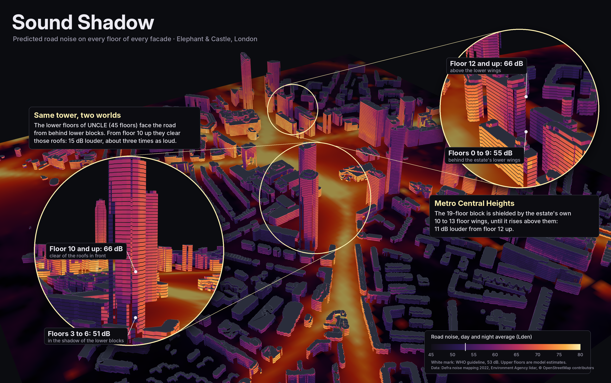

# Sound Shadow

A vertical sound map of Elephant & Castle, London: how loud is road traffic
on each floor of each building, and how much quieter is it behind a tall one?

## The idea

Official noise maps are calculated at one height, 4 m above ground. This
project asks what happens above that, in a place where 40-storey towers stand
next to two-storey terraces.

1. **Learn shielding from official data.** Defra's 2022 road noise map gives
   a value every 10 m at 4 m height. A model learns to predict it from
   geometry only: how far away the roads are, how big they are, and how much
   of them is hidden behind buildings.
2. **Test on streets the model never saw.**
3. **Go up.** Recompute the same geometry for every floor and predict again.

## What is and isn't checked

- Predictions at 4 m are checked against official values.
- Predictions on higher floors are **extrapolated**. No open London dataset
  has noise per floor, so nothing confirms them.

## Data

| Data | Source |
|---|---|
| Road noise at 4 m, 10 m grid, 2022 mapping (Lden, Lnight, 8 pitch bands) | Defra, Open Government Licence |
| Surface and ground height, 1 m grid, from laser scans | Environment Agency, Open Government Licence |
| Building outlines, roads, railways | OpenStreetMap contributors, ODbL |

## How "hidden" is worked out

A straight line is drawn from every road point to the listener, and the laser-scan
heights are checked every 2 m along it. If a building sticks out above the line,
the sound has to bend over it; the further it has to bend, the more is lost
(Maekawa's rule of thumb from acoustics). Only heights inside building outlines
count, so trees don't block anything.

## Steps

| File | Does |
|---|---|
| `01_get_data.py` | Downloads everything for a 1.6 km square and prints a report |
| `02_geometry.py` | Building heights, listening points (official 4 m grid, and every floor of every facade), and for each point how much road it can see and how much is hidden behind buildings |
| `03_model.py` | Trains models on the official 4 m values, tests them on 200 m blocks they never saw, and predicts every floor |
| `04_slice.py` | A vertical slice north to south across New Kent Road: predicted noise in the air up to 120 m, with buildings as silhouettes (`charts/5_slice.png`) |
| `05_map.py` | Builds `map/index.html`: buildings in 3D, the official noise map on the ground, every floor of every facade lit by its predicted noise |

## Results so far

Average error on blocks the model never saw (Lden, dB):

| Model | Error |
|---|---|
| Average everywhere | 8.8 |
| Distance to the nearest main road | 5.0 |
| Straight line, all geometry features | 3.9 |
| Boosted trees, all geometry features | 2.8 |

Shuffling points at random instead makes the boosted trees look better (2.1 dB),
because neighbouring points are nearly identical. That is why the test uses
whole blocks.

Going up a facade, the model predicts that walls facing a busy road get
quieter (about 4 dB by floor 20, 7 dB by floor 30), while sheltered walls get
louder (about 2 dB by floor 10, 4 dB by floor 20) once they rise above the
roofs that shield them. The clearest case is the south face of UNCLE: about
51 dB on floors 3 to 6, behind lower blocks, and 66 dB from floor 10 up.

## Known limits

- Upper floors are extrapolated: no open data checks them.
- On the 1st floor the model reads about 2.5 dB lower than the official cell in
  front of the same wall, probably because it never trained on points right
  next to a facade, where reflections add a few dB.
- Road type stands in for traffic counts, and the railway viaduct is left out.
